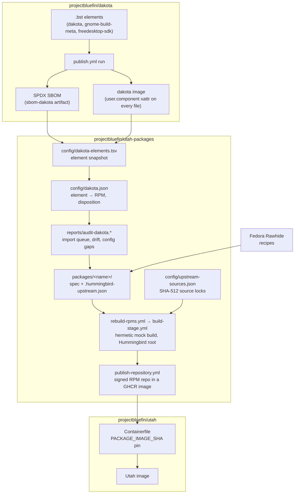

# From Dakota's BuildStream elements to Utah's RPMs

This page describes the whole path from a BuildStream (`.bst`) element in
Dakota to an RPM installed in a Utah image. It links to the detailed skill
pages for each step. Numbers are from 2026-11-18.

## The short version

Dakota is GNOME OS built with BuildStream, on gnome-build-meta and
freedesktop-sdk. Utah is the same desktop built from RPMs, on Hummingbird.
**No tool turns a `.bst` file into a spec file.** The pipeline does this:

1. It measures what Dakota ships, element by element.
2. It maps each element to the RPM that provides it on Utah.
3. A person (or an agent) writes or imports the recipe for each gap, and
   aligns it with the element.
4. The factory builds the recipes against Hummingbird and publishes them as
   one signed RPM repository.
5. Utah pins that repository by digest and installs from it.

## Step 1: measure Dakota

Dakota has no RPM database, so the factory measures it from two outputs of
one Dakota publish run:

- **The SBOM.** Dakota's `publish.yml` uploads an SPDX SBOM (`sbom-dakota`).
  It names every element and the sources of each one.
- **The image.** chunkah writes the owning element of every file into the
  `user.component` xattr. `tools/audit_dakota.py --import-sbom` reads it from
  each layer of the pinned image, so "this element ships in the image" is
  measured, not guessed.

The result is `config/dakota-elements.tsv`: one row per element, with its
primary source version and URL, its patch count, and how many files, desktop
entries, systemd units and commands it owns in the image.

`config/dakota.json` `source` pins the Dakota revision, the publish run, the
image digest and the junction refs. The current pin is Dakota `bf271777` on
`testing`, with gnome-build-meta `gnome-51` and freedesktop-sdk `26.08`.

To move the pin, see
[`skills/dakota-parity.md`](skills/dakota-parity.md#commands).

## Step 2: map each element to an RPM

`tools/audit_dakota.py` gives every element a **disposition**. The first rule
that matches wins:

| Disposition | Meaning | Count |
| --- | --- | --- |
| `structural` | A Utah parity issue decides it (#1222–#1236) | 37 |
| `not-applicable` | Build-only: the element owns no file in the image (toolchains, bootstrap, `-devel`-only), or it is image machinery | 410 (29 own files) |
| `dakota-config` | A Dakota element that only installs files | 10 |
| `gnomeos-config` | A gnome-build-meta element whose sources are all local | 6 |
| `factory` | A recipe for the RPM is in `packages/` | 468 |
| `hummingbird` | Hummingbird already builds the source package | 237 |
| `fedora-importable` | Fedora Rawhide has a recipe; import it | 31 |
| `new-spec` | No Fedora recipe; write the spec from the `.bst` | 5 |

`factory`, `hummingbird` and `fedora-importable` are measured against
Rawhide's and Hummingbird's repodata, never asserted. Reviewer decisions go
in `config/dakota.json` as `overrides`, `aliases` (when the element name and
the Fedora name differ, for example `sdk/mozjs.bst` → `mozjs140`) and
`config_subpackages`. The `elements` mapping is generated by `--refresh`.
Don't edit it by hand.

The audit report (`reports/audit-dakota.{json,md}`) is not committed. Every
`validate.yml` run publishes it as the `dakota-audit` artifact. It holds:

- **the import queue**: elements with no recipe yet, user-visible ones first
  (desktop entries, then systemd units, then commands, then libraries). It
  has 2 entries now.
- **version drift**: for each `factory` element, the locked version compared
  with Dakota's, by release line. Now: 361 aligned, 57 need review, 50 cannot
  be compared (Dakota pins a bare commit).
- **config gaps**: config elements with no subpackage yet.

`just dakota-audit` (part of `just check`) is the gate. It fails when the
mapping doesn't name exactly the snapshot's elements, or an override names
an element that isn't there. Stale dispositions don't fail it.

## Step 3: write or import the recipe

The owner policy is in
[`skills/dakota-parity.md`](skills/dakota-parity.md#owner-policy):

- **Upstream components follow Fedora, then Dakota.** Import Fedora's Rawhide
  recipe. Then align it with the element: the same version or ref, the same
  patches, the same configure or meson options. Read those from the `.bst`
  in Dakota, or in gnome-build-meta or freedesktop-sdk at the junction ref.
  For GNOME modules, `tools/audit_gnome_build_meta.py` compares patches and
  `-D` options for you
  ([`skills/gnome-build-meta-audit.md`](skills/gnome-build-meta-audit.md)).
- **`new-spec` elements** get a spec written from the element. Source0 is the
  element's source URL at its ref, locked like any other source. The build
  follows the element's `kind` and variables. First confirm that Fedora
  really has no recipe: a retired Fedora package usually means a rename, so
  the fix is an alias.
- **Config elements become subpackages**, with Dakota's files used
  unchanged: `dakota-config-<element>` built from projectbluefin/dakota at
  the pinned commit, and `gnome-os-config-<element>` from gnome-build-meta.
  Utah installs these RPMs instead of copying files by hand
  ([`skills/config-packages.md`](skills/config-packages.md)).

Each recipe is a directory `packages/<name>/` with the spec, patches, a
`sources` manifest, and `.hummingbird-upstream.json` (where the recipe came
from: a Fedora dist-git commit, or `branch: upstream` for a project
remote).

Some decisions are Utah's, not Dakota's. The owner set these:

- **Apps are Flatpak-first.** A Dakota element that ships an app natively
  (Papers, Ghostty) doesn't become a native package in Utah when a Flatpak
  exists. Native packages are for system components.
- **No systemd-homed for now.** Utah keeps a clean migration path from
  Fedora and Bluefin.

## Step 4: lock the sources

Payloads come from upstream releases. Fedora only supplies the recipe.
`config/upstream-sources.json` records each primary source with its URL and
SHA-512. `tools/source_pipeline.py` fetches and checks them before a build.

When no upstream publishes the archive a recipe needs (a vendored Rust or Go
tree, a release with non-free files removed, files picked from a large
repository), `tools/generated_sources.py` builds it from a pinned upstream
input. The lock records the SHA-512 of the result, and verification re-runs
the transformation and fails on any difference
([`skills/supply-chain-provenance.md`](skills/supply-chain-provenance.md)).

## Step 5: build

`rebuild-rpms.yml` runs on every push to `main` and on a daily schedule. It:

1. **plans** which packages to build: changed recipes, plus everything that
   depends on them;
2. **orders** them into stages (`rebuild0`, `rebuild1`, and so on), so a
   package builds after the packages it needs;
3. calls **`build-stage.yml`** for each stage, one job per package.

The default build lane is **hermetic**, the way Hummingbird builds:

1. `hermetic_build.sh lock`: mock resolves the real `BuildRequires` online
   against Fedora 44, Hummingbird and the earlier stages, and writes
   `buildroot_lock.json`.
2. `hermetic_build.sh build`: the locked RPMs are downloaded, and
   `tools/verify_hermetic_repo.py` checks each one against the lock
   (SIGMD5, name, version, release, arch; nothing missing or extra). mock
   then builds offline from exactly that set.

Packages build with the disttag `.hum1.bfin`, so their sonames match the
Hummingbird image they go into. A cache keyed on the lock skips a package
whose inputs didn't change
([`skills/package-build-cache.md`](skills/package-build-cache.md)).

## Step 6: publish

`publish-repository.yml` adds the stage RPMs to the previous repository,
replacing each rebuilt source package as a whole. It runs these checks:

- **precedence**: the factory's builds must outrank Fedora's and
  Hummingbird's for the same package;
- **consumer transaction**: what Utah installs must resolve as one dnf
  transaction against this repository and Hummingbird ("Validate
  Hummingbird-only consumer transaction").

It signs the repository metadata, then pushes the repository as an OCI image,
`ghcr.io/projectbluefin/utah-packages`, signed with cosign and with a build
provenance attestation.

## Step 7: Utah consumes it

Utah's `Containerfile` pins the repository image by digest
(`PACKAGE_IMAGE_SHA`), bind-mounts it at `/etc/utah-packages` and installs
from it next to Hummingbird's repository. Renovate opens a pull request in
projectbluefin/utah when the digest moves, so each Utah build can be traced
to an exact package set.

## Keeping it current

| What moves | Job | Doc |
| --- | --- | --- |
| Dakota's elements | `audit-dakota.yml`, weekly (dispatch with `refresh` to re-resolve) | [`skills/dakota-parity.md`](skills/dakota-parity.md) |
| GNOME release line | `audit-gnome-build-meta.yml` | [`skills/gnome-build-meta-audit.md`](skills/gnome-build-meta-audit.md) |
| Fedora recipes | `detect-rawhide-updates.yml`, daily `bump/rawhide-imports` PR, only for recipes with no local changes | [`skills/rawhide-recipe-reimports.md`](skills/rawhide-recipe-reimports.md) |
| Upstream versions | `bump-upstream-sources.yml`, daily | [`skills/upstream-version-bumps.md`](skills/upstream-version-bumps.md) |

## Known problems (2026-11-18)

- **Full rebuilds couldn't publish.** A full rebuild makes about 1,700
  artifacts. The publish step's download listed only the first 1000, so it
  missed the newest stages and failed its consumer transaction check (#970). The fix is
  #1204.
- **Full rebuilds are slow.** One takes about 10 hours, and only one runs at a
  time. A merge can take most of a day to reach the published repository.
- **Hummingbird's package server is flaky.** Most failed builds in a large
  run are transient download errors. Retry PRs: #1162, #1173, #1181, #1195.
- **Package signatures are not checked yet.** Builds resolve with
  `gpgcheck=0`. The hermetic lane now checks downloads against the lock, and
  pinning the Fedora and Hummingbird keys is in progress.
- **Drift.** 57 factory packages are behind or ahead of Dakota's release line
  and need review. They're listed in the audit report.
- **The build container differs from what `AGENTS.md` says.** Builds run in
  `quay.io/fedora/fedora:44`, not the pinned Packit image. See
  [`architecture.md`](architecture.md) and #43.
