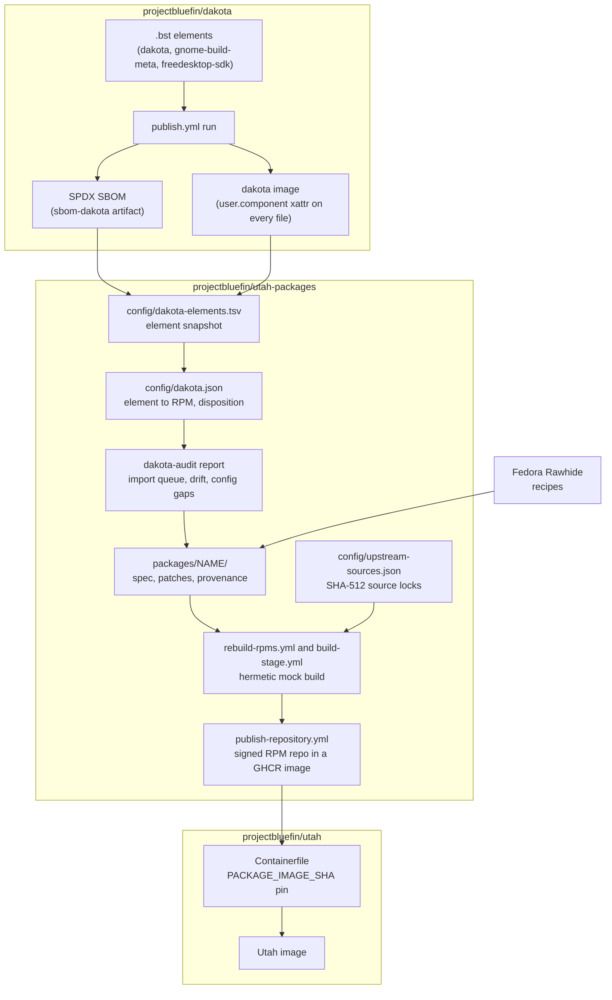

# From Dakota's BuildStream elements to Utah's RPMs

This page describes the whole path from a BuildStream (`.bst`) element in
Dakota to an RPM installed in a Utah image. Each step links to the skill page
that has the details.

## The short version

Dakota is GNOME OS built with BuildStream, on gnome-build-meta and
freedesktop-sdk. Utah is the same desktop built from RPMs, on Hummingbird.
**No tool turns a `.bst` file into a spec file.** The pipeline does this:

1. It measures what Dakota ships, element by element.
2. It maps each element to the RPM that provides it on Utah.
3. A person (or an agent) writes or imports the recipe for each gap, and
   aligns it with the element.
4. The factory builds the recipes against Hummingbird and publishes them as
   one signed RPM repository.
5. Utah pins that repository by digest and installs from it.

## Step 1: measure Dakota

Dakota has no RPM database, so the factory measures it from two outputs of
one Dakota publish run:

- **The SBOM.** Dakota's `publish.yml` uploads an SPDX SBOM (`sbom-dakota`).
  It names every element and the sources of each one.
- **The image.** chunkah writes the owning element of every file into the
  `user.component` xattr. `tools/audit_dakota.py --import-sbom` reads it from
  each layer of the pinned image, so "this element ships in the image" is
  measured, not guessed.

The result is `config/dakota-elements.tsv`: one row per element, with its
primary source version and URL, its patch count, and how many files, desktop
entries, systemd units and commands it owns in the image.

`source` in `config/dakota.json` pins the Dakota revision, the publish run,
the image digest and the junction refs (gnome-build-meta and
freedesktop-sdk). To move the pin, see
[`skills/dakota-parity.md`](skills/dakota-parity.md#commands).

## Step 2: map each element to an RPM

`tools/audit_dakota.py` gives every element a **disposition**. The first rule
that matches wins:

1. A reviewer **override** in `config/dakota.json`, with a reason. It can set
   `structural` (a projectbluefin/utah parity issue decides the element,
   [utah#1222](https://github.com/projectbluefin/utah/issues/1222)–[utah#1235](https://github.com/projectbluefin/utah/issues/1235) or the epic [utah#1236](https://github.com/projectbluefin/utah/issues/1236)), `not-applicable`,
   `dakota-config`, `gnomeos-config` or `new-spec`.
2. `not-applicable`: the element is build-only. It owns no file in the image
   (a toolchain, a bootstrap stage, a `-devel`-only library).
3. `dakota-config` or `gnomeos-config`: the element only installs files its
   project wrote (Dakota, or gnome-build-meta with only local sources).
4. Otherwise, the first of these that is true:
   - `factory`: a recipe for the RPM is in `packages/`;
   - `hummingbird`: Hummingbird already builds the source package;
   - `fedora-importable`: Fedora Rawhide has a recipe to import;
   - `new-spec`: there is no Fedora recipe, so the spec is written from the
     `.bst`.

`factory`, `hummingbird` and `fedora-importable` are measured against
Rawhide's and Hummingbird's repodata, never asserted, so an override can't
set them. When an element's name and its Fedora name differ (for example
`sdk/mozjs.bst` and `mozjs140`), add an `aliases` entry. The `elements`
mapping is generated by `--refresh`; don't edit it by hand.

The audit report is not committed, because every recipe import changes it
([#309](https://github.com/projectbluefin/utah-packages/issues/309)). Every `validate.yml` run publishes it as the `dakota-audit` artifact
and in its job summary. Run `python3 tools/audit_dakota.py` to make it
locally. It holds:

- **the import queue**: elements that still need a recipe, one row per RPM,
  user-visible ones first (desktop entries, then systemd units, then
  commands, then libraries and data);
- **version drift**: for each `factory` element, the locked version compared
  with Dakota's by release line, classified `aligned`, `needs_review` or
  `not_compared` (Dakota pins a bare commit, so there is no version);
- **stale mappings**: recipes that landed after the last `--refresh`. These
  are expected, and the next refresh records them;
- **config gaps**: config elements with no subpackage yet.

As of 2026-11-18 (Dakota `bf271777`): 468 elements map to factory recipes,
237 to Hummingbird, 31 RPMs can be imported from Rawhide, 5 need a new spec,
and 57 elements need a drift review.

`just dakota-audit` (part of `just check`) is the gate. It fails when the
mapping doesn't name exactly the snapshot's elements, or when an override,
alias or config entry names an element the snapshot doesn't have. Stale
dispositions don't fail it.

## Step 3: write or import the recipe

The owner policy is in
[`skills/dakota-parity.md`](skills/dakota-parity.md#owner-policy):

- **Upstream components follow Fedora, then Dakota.** Import Fedora's Rawhide
  recipe. Then align it with the element: the same version or ref, the same
  patches, the same configure or meson options. Read those from the `.bst`
  in Dakota, or in gnome-build-meta or freedesktop-sdk at the junction ref.
  For GNOME modules, `tools/audit_gnome_build_meta.py` compares patches and
  `-D` options for you
  ([`skills/gnome-build-meta-audit.md`](skills/gnome-build-meta-audit.md)).
- **`new-spec` elements** get a spec written from the element. Source0 is the
  element's source URL at its ref, locked like any other source. The build
  follows the element's `kind` and variables. First confirm that Fedora
  really has no recipe: a retired Fedora package usually means a rename, so
  the fix is an alias.
- **Config elements become subpackages**, with the project's files used
  unchanged: `dakota-config-<element>` built from projectbluefin/dakota at the
  pinned commit, and `gnome-os-config-<element>` from gnome-build-meta. Utah
  installs these RPMs instead of copying files by hand
  ([`skills/config-packages.md`](skills/config-packages.md)).

Each recipe is a directory `packages/<name>/` with the spec, patches, a
`sources` manifest, and `.hummingbird-upstream.json`. That file records where
the recipe came from: a Fedora dist-git commit, or `branch: upstream` for a
project remote.

Utah's image policy can differ from Dakota's: for example, Flatpak-first apps
([projectbluefin/utah#1270](https://github.com/projectbluefin/utah/issues/1270)) and no systemd-homed ([projectbluefin/utah#1238](https://github.com/projectbluefin/utah/issues/1238)).
Check the Utah issue before you package a Dakota element that the image
doesn't need.

## Step 4: lock the sources

`config/upstream-sources.json` records each package's primary source with
its URL and SHA-512. `tools/source_pipeline.py` fetches and checks them
before a build.

The aim is that payloads come from the project's own releases and Fedora
supplies only the recipe. That isn't yet true for every package:

- `config/fedora-primary-sources.txt` lists the packages whose primary source
  still comes from Fedora's lookaside. The validator treats it as a ratchet:
  the list can only shrink. For how to move a package off it, see
  [`skills/supply-chain-provenance.md`](skills/supply-chain-provenance.md#moving-a-lookaside-lock-to-an-upstream-release).
- Some extra files a recipe bundles (a key ring, a vendored tree) are fetched
  from Fedora's lookaside by digest.

When no upstream publishes the archive a recipe needs (a vendored Rust or Go
tree, a release with non-free files removed, files picked from a large
repository), `tools/generated_sources.py` builds it from a pinned upstream
input. The lock records the SHA-512 of the result. Verification re-runs the
transformation and fails on any difference.

## Step 5: build

`rebuild-rpms.yml` runs on these triggers:

- a push to `main` that changes `packages/` or `config/`;
- daily (03:17 UTC): what changed, plus a retry of each package whose last
  attempt failed;
- weekly (Sunday 01:23 UTC): every package.

Its `prepare` job does the planning:

1. It reads the published factory image. Its label records what each
   published build was made from, so the run builds only what changed.
2. It adds the reverse dependencies of those packages, from the real
   `BuildRequires` of every recipe (`tools/build_graph.py`).
3. It orders the result into waves (`rebuild0`, `rebuild1`, and so on), so a
   package builds after the packages it needs. `build-stage.yml` runs each
   wave, one job per package.

**The build root** is `ghcr.io/projectbluefin/utah-buildroot`, the factory's
own copy of `fedora:44`. It is pinned by
digest in `config/buildroot-image` and moved weekly by
`refresh-buildroot.yml`. The run pulls it once and gives the same bytes to
every job.

**The lane** is hermetic, the way Hummingbird builds:

1. `hermetic_build.sh lock`: mock resolves the real `BuildRequires` online
   against Fedora 44, Hummingbird and the earlier waves, and writes
   `buildroot_lock.json`.
2. `hermetic_build.sh build`: the locked RPMs are downloaded, and
   `tools/verify_hermetic_repo.py` checks each one against the lock
   (SIGMD5, name, version, release, arch; nothing missing or extra). mock
   then builds offline from exactly that set.

A package can be put on the older container lane with
`build_lane: container` in its source lock. That lane skips the lock and the
check. No package uses it today.

Packages build with the disttag `.<humN>.bfin` (today `.hum1.bfin`). `humN` is
read from the Hummingbird packages in the build root. The tag names Hummingbird
as the target and sorts above Hummingbird's own `.hum1` at an equal release
([`targeting-hummingbird.md`](targeting-hummingbird.md)).

**The cache.** After the lock step, a package whose inputs didn't change is
taken from the package cache, and its offline build is skipped. The cache key
covers the recipe files, the build-root digest, every NEVRA in the resolved
root, and the disttag
([`skills/package-build-cache.md`](skills/package-build-cache.md)).

## Step 6: publish

`publish-repository.yml` starts from the previous published repository and
replaces each rebuilt source package as a whole. Before it pushes, it runs
two checks:

- **precedence**: the factory's builds must outrank Fedora's and
  Hummingbird's for the same package;
- **consumer transaction**: what Utah installs must resolve as one dnf
  transaction against this repository and Hummingbird ("Validate
  Hummingbird-only consumer transaction").

A run publishes more than once:

- **early publications**: up to four (`publish0`–`publish3`), each after one
  of the first waves, so a package can ship before the slowest package in the
  run is done.
  An early publication that fails the consumer transaction pushes nothing
  and doesn't fail the run. For example, a library can move its soname
  before its consumers are rebuilt. The next publication tries again;
- **the final publication**: one at the end, covering every wave. If it fails
  the consumer transaction, the run fails.

A publication that passes signs the repository metadata, then pushes the
repository as an OCI image, `ghcr.io/projectbluefin/utah-packages`. The image
is signed with cosign and has a build provenance attestation.

## Step 7: Utah consumes it

Utah's `Containerfile` pins the repository image by digest
(`PACKAGE_IMAGE_SHA`), bind-mounts it at `/etc/utah-packages` and installs
from it next to Hummingbird's repository. A bot opens a pull request in
projectbluefin/utah when the digest moves, so each Utah build can be traced
to an exact package set.

## Keeping it current

| What moves | Job | Doc |
| --- | --- | --- |
| Dakota's elements | `audit-dakota.yml`, weekly (dispatch with `refresh` to re-resolve) | [`skills/dakota-parity.md`](skills/dakota-parity.md) |
| GNOME release line | `audit-gnome-build-meta.yml` | [`skills/gnome-build-meta-audit.md`](skills/gnome-build-meta-audit.md) |
| Fedora recipes | `detect-rawhide-updates.yml`, daily `bump/rawhide-imports` PR, only for recipes with no local changes | [`skills/rawhide-recipe-reimports.md`](skills/rawhide-recipe-reimports.md) |
| Upstream versions | `bump-upstream-sources.yml`, daily | [`skills/upstream-version-bumps.md`](skills/upstream-version-bumps.md) |

## Known problems

Each has a tracking issue with the current state:

- Full rebuilds can't publish: the artifact download misses the newest
  waves ([#970](https://github.com/projectbluefin/utah-packages/issues/970)).
- Full rebuilds take 7–10 hours, so a merge can take most of a day to
  publish ([#1207](https://github.com/projectbluefin/utah-packages/issues/1207)).
- Hummingbird's package server causes most failed builds in large runs
  ([#1208](https://github.com/projectbluefin/utah-packages/issues/1208)).
- Factory recipes have drifted from Dakota's versions ([#1051](https://github.com/projectbluefin/utah-packages/issues/1051), [#1136](https://github.com/projectbluefin/utah-packages/issues/1136)).
